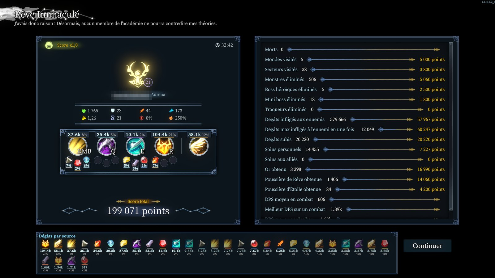
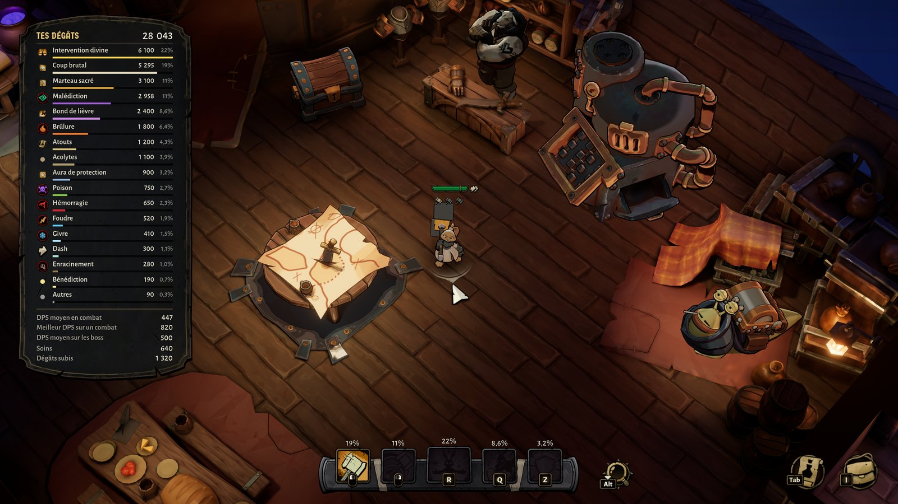

# DPS meters

Des DPS meters intégrés à l'interface de tes jeux, dans leur style d'origine : tes dégâts, ton DPS et ce qui les fait, en solo comme en multi.

| Jeu | DPS meter |
| --- | --- |
| Shape of Dreams | Dream DPS Meter |
| Raiders of Blackveil | Blackveil DPS Meter |

## Installer

### [⬇️ Télécharger l'installeur](https://github.com/Ghermin/dream-dps-meter/releases/download/installer/Installer-DPS-Meters.exe)

Ferme le jeu, ouvre l'installeur, coche tes jeux, clique sur **Installer**. Les mises à jour se font ensuite toutes seules.

Dans Shape of Dreams, active-le une fois dans le menu **Mods** de l'écran titre.

Si Windows affiche « Windows a protégé votre ordinateur » : **Informations complémentaires**, puis **Exécuter quand même**.

Plus d'infos sur la [page du projet](https://ghermin.github.io/dream-dps-meter/).

---

Projet de fan, sans lien avec les studios des jeux. Licence MIT.
