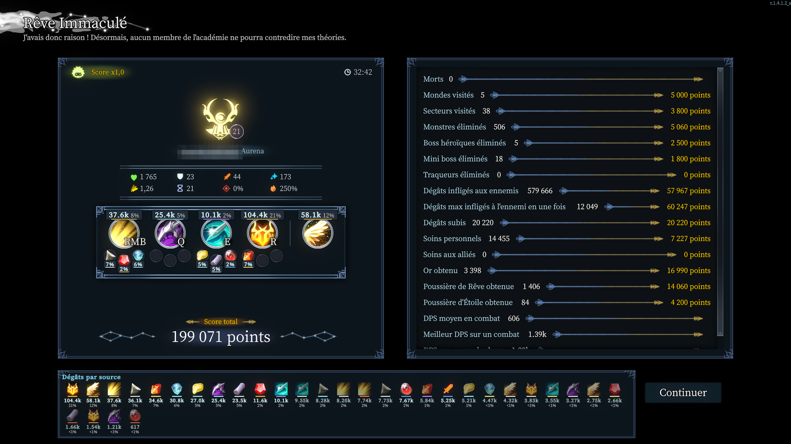

# DPS meters de Ghermin — Shape of Dreams et Raiders of Blackveil

Deux DPS meters intégrés au HUD de leur jeu, avec le style de l'interface d'origine, installables indépendamment :

- **Dream DPS Meter** pour *Shape of Dreams* (mod du gestionnaire de mods du jeu) ;
- **Blackveil DPS Meter** pour *Raiders of Blackveil* (plugin BepInEx 5, installé automatiquement).

100 % côté client : ils ne changent rien au gameplay et marchent en multi, même si les autres joueurs ne les ont pas installés.



## Installation (un double-clic)

### ⬇️ [Télécharger l'installateur](https://github.com/Ghermin/dream-dps-meter/releases/download/installer/Installer-DPS-Meters.bat)

1. Ferme le jeu, puis double-clique sur **Installer-DPS-Meters.bat** (dans tes Téléchargements).
   Si Windows affiche « Windows a protégé votre ordinateur » : **Informations complémentaires → Exécuter quand même**
   (le fichier n'est pas signé ; il ne fait que lancer `install.ps1` depuis ce dépôt).
2. Choisis ce que tu veux installer, puis Entrée :

   ```
     Quel(s) DPS meter(s) installer ?
      [1] Dream DPS Meter      pour Shape of Dreams      (trouvé : ...)
      [2] Blackveil DPS Meter  pour Raiders of Blackveil (trouvé : ...)
      [3] Les deux
   ```

   Entrée seule = les jeux trouvés sur le PC.

3. **Shape of Dreams** : lance le jeu → menu **Mods** sur l'écran titre → active **Dream DPS Meter**.
   **Raiders of Blackveil** : rien à faire, il est actif au prochain lancement du jeu.

<details>
<summary>Sans télécharger de fichier : la même chose en une commande PowerShell</summary>

Ouvre **PowerShell** (touche Windows, tape `PowerShell`, Entrée), colle cette ligne et valide :

```powershell
irm https://raw.githubusercontent.com/Ghermin/dream-dps-meter/main/install.ps1 | iex
```

Sans question : `$env:DPS_METERS='blackveil'` (ou `dreams`, ou `dreams,blackveil`) avant la commande.
</details>

Le script trouve les jeux dans tes bibliothèques Steam et installe :
- `Shape of Dreams\Mods\DreamDpsMeter` ;
- `Raiders of Blackveil\BepInEx\plugins\BlackveilDpsMeter`, avec [BepInEx 5](https://github.com/BepInEx/BepInEx) s'il n'est pas déjà là.
  Si BepInEx 6 est déjà installé dans le jeu (par un autre mod), le script s'arrête et explique quoi faire.

**Mises à jour : rien à faire.** Au lancement du jeu, chaque mod vérifie s'il existe une nouvelle version sur ce dépôt et la télécharge.
Shape of Dreams l'applique tout de suite sur l'écran titre (sinon au retour au menu principal) ;
Raiders of Blackveil l'applique au lancement suivant (BepInEx ne recharge pas les plugins en cours de partie).

## Raiders of Blackveil

**En permanence, sous le bloc « Étage / Alerte »** (il s'efface avec lui quand une page s'ouvre) :
- tes dégâts de la run, le DPS du combat en cours (ou DPS boss, ou celui du dernier combat, grisé) ;
- PV soignés / perdus ;
- en multi : classement des joueurs par dégâts, avec leur part.

**Alt maintenu (quand le jeu affiche les détails des compétences) — le même panneau passe au détail** :
- tes dégâts par compétence (avec le nom et l'icône de la compétence de ton champion), dash, sbires, perks
  et altérations (brûlure, poison, saignement, malédiction, choc, racines, givre…), avec leur part ;
- DPS moyen en combat, meilleur DPS sur un combat, DPS moyen sur les boss, soins, dégâts subis.

**Barre de compétences** : un petit % au-dessus de chaque compétence (part de tes dégâts).

**Écran de fin**, dans la section « Combat » du récapitulatif : DPS moyen en combat, meilleur DPS sur un combat,
DPS moyen sur les boss, temps en combat.

En multi, seul l'hôte voit la compétence à l'origine de chaque coup : en tant que client, ton détail sépare
« coups directs » et altérations. Les totaux, DPS et classement sont justes pour tout le monde.

Au vaisseau, les dégâts sur les mannequins sont comptés (remis à zéro en partant en run).

## Shape of Dreams

**Pendant la run — au-dessus des caractéristiques** (même cadre que la fenêtre de stats ; à sa place si elle est masquée) :
- dégâts totaux de la run, DPS du combat (ou DPS sur le boss pendant un combat de boss), soins, dégâts subis ;
- or et Poussière de Rêve gagnés, répartition des dégâts par élément (barre colorée) ;
- en multi : classement des joueurs par dégâts (une ligne de résumé par joueur).

**Touche Ctrl — le même panneau passe au détail** (jamais deux panneaux l'un sur l'autre) :
- le détail de tes dégâts par mémoire, essence, passif, élément (brûlure, givre…) et attaque de base, avec icônes ;
- soins et boucliers apportés par chaque source (non comptés dans le DPS) ;
- 7 sources visibles, au-delà la liste défile ligne par ligne (molette sur la liste, ou glisser la barre).

**Barre de compétences** : un petit % au-dessus de chaque mémoire et sous chaque essence (part de tes dégâts).

**Écran de fin** :
- dégâts et part de chaque mémoire / essence directement sur le panneau du héros ;
- lignes « DPS moyen en combat », « Meilleur DPS sur un combat », « DPS moyen sur les boss » dans la liste de stats ;
- « Dégâts par source » : toutes les sources de la run, y compris les essences et mémoires abandonnées en route (grisées).

**Options** : aucune, tout est réglé une fois pour toutes (fin de combat après 5 s sans dégâts, overkill compté,
7 sources visibles dans le détail, mises à jour automatiques).

Commandes console (mode développeur) : `dps_reset`, `dps_rebuild`, `dps_mock` (données de test).

## Développement

**Shape of Dreams** — le projet `DreamDpsMeter.csproj` (racine du dépôt) se trouve directement dans `Shape of Dreams\Mods\DreamDpsMeter`
(il référence les DLL du jeu via `..\..`) ; `release.ps1` le trouve aussi depuis un clone hors du dossier `Mods`.

**Raiders of Blackveil** — `blackveil\BlackveilDpsMeter.csproj` référence les DLL du jeu et de BepInEx dans le dossier Steam
(`-p:GameDir=...` pour un autre chemin) et copie la DLL dans `BepInEx\plugins\BlackveilDpsMeter` à chaque compilation.
Option de développement : `Outils = true` dans `BepInEx\config\ghermin.blackveildpsmeter.cfg` → dump de l'interface
(`F8`, et à chaque nouvelle page) dans `BepInExlackveil_ui_dump.txt`, captures dans `BepInEx\shots`.

```powershell
dotnet build -c Release                                   # Shape of Dreams : compile et copie DreamDpsMeter.dll à la racine du mod
dotnet build blackveil -c Release                         # Raiders of Blackveil : compile et copie dans BepInEx\plugins
.
elease.ps1                                             # publie Dream DPS Meter (1.1.6 -> 1.1.7) : DLL dans release\, tag vX.Y.Z
.
elease.ps1 1.2.0                                       # idem avec un numéro choisi
.
elease.ps1 -Mod blackveil                              # publie Blackveil DPS Meter : DLL dans blackveil
elease\, tag blackveil-vX.Y.Z
```

L'installateur `Installer-DPS-Meters.bat` est attaché à la release GitHub `installer` (lien fixe) ; il télécharge toujours
le dernier `install.ps1`, il n'y a donc à le republier que s'il change :
`gh release upload installer Installer-DPS-Meters.bat --clobber` (création la première fois :
`gh release create installer Installer-DPS-Meters.bat --title "Installateur" --notes "Double-clic pour installer les DPS meters."`).

Un simple `git push` ne met personne à jour : la mise à jour auto compare `release/version.txt` (ou `blackveil/release/version.txt`)
et télécharge la DLL publiée à côté, que seul `release.ps1` reconstruit (la compilation a besoin des DLL du jeu, donc en local).
